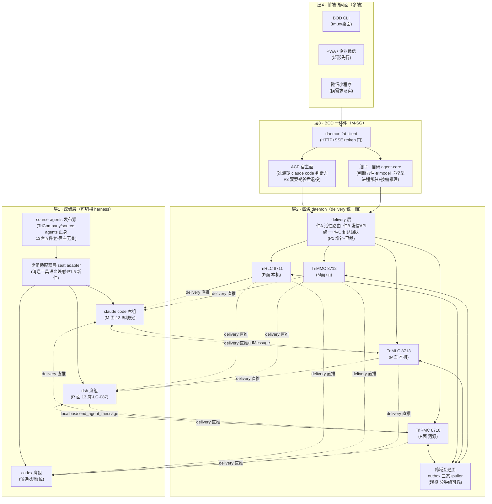

# CTO 终态架构设计卷 · 四域席组可切换+BOD 一体件（CEO 思路出卷·呈批件）· 2026-10-16

- sourceOfTruth: 本卷（trees/lg085-bod-cli-acp-review/cto-terminal-architecture-design-20261016.md）
- syncMode: static（终态架构设计·呈批件·经 COS 呈 CEO）
- lastSyncedAt: 2026-10-16T22:16:33+08:00（date 现查·写前跑）
- 令源: CEO 22:12:54 三裁决（LG-085② 终裁落账：P0 维持搁置/双案分阶段认/P1 增补 delivery 层件 A/B）+终态架构思路原话（COS 22:13:53 忠实转录）
- 设计硬约束（CEO 明示）：a.**席组可切换**=四域随时换 codex/claude code/dsh/其他·source-agents 发布源·切换零成本；b.**脑子=自研 agent-core**（非 claude code 会话承载）

## 〇·架构总图（终态全景）

**一句话读图**：CEO 只面对层4 多端；层3 BOD 一体件=脑子（自研 agent-core 终态·claude code 过渡）+fat client；层2 四 daemon=状态与消息唯一真源（delivery 层保证「推送到席」语义）；层1 席组=source-agents 正身经适配器层发布到任意 harness——**换席组=换发布目标，BOD 与 daemon 层零改动**。

## 一·席组可切换性设计（硬约束 a·本卷新增主件）

**原理：身份与消息两轴解耦 harness**——

| 轴 | 承载 | 切换 harness 时 |
| --- | --- | --- |
| 身份轴（五件套：soul/agent-body/session-body/memory/colleagues） | **source-agents 发布源**（现役正身·宿主无关） | 零改动 |
| 消息轴（收发工具语义） | **席组适配器层**（新件） | 按目标 harness 映射 |

**适配器层职责**（P1.5 新件·映射表驱动）：

| harness | 发形（现役） | 收形（现役） | 适配器映射 |
| --- | --- | --- | --- |
| claude code | SendMessage（uds pipe） | uds 直推+复活补读 | ↔ daemon send API（件 B）|
| dsh | send_agent_message（localbus·进程内） | ACP 适配层注入桥（段A 施工形） | ↔ daemon send API |
| codex | send_message_to_thread（候选勘验） | 候勘验 | ↔ daemon send API |

- **「域内同类型 cli 互发」现役已有**（各 harness 自带）；缺的是**跨 harness 统一语义**——正解=daemon send API（件 B）为唯一统一面，各 harness 的消息工具注册为它的映射壳（agent-core registerTool 形现役先例=TriRLC send-message.ts）。
- **切换零成本的机械判据**：换 harness=①发布管线换宿主目标（FADE 管线现役+转译器：claude code 直发/dsh 转译器现役 LG-087 n2/codex 转译器候勘）②适配器映射表加一行——**BOD/daemon/source-agents 三层零改动**。

## 二·缺漏盘点（全量对表现役·含五问卷已勘缺口）

| # | 缺口 | 现役实态 | 状态 |
| --- | --- | --- | --- |
| 1 | **最后一跳推送**（落箱→席会话） | 信箱落箱即终态·无活性路由 | 已勘（五问卷）·**P1 已裁增补** |
| 2 | 发信 API 统一 | 各 harness 语义异构·daemon 面多点 | 已勘·**P1 已裁增补** |
| 3 | 到达回执闭环 | outbox 三态止于落箱 | 已勘·随 P1 |
| 4 | **席组适配器层** | 无——各 harness 收发语义未统一映射 | **本卷新勘·P1.5** |
| 5 | codex 转译器+勘验 | codex 现役零部署 | 本卷新勘·观察位 |
| 6 | 脑子承载（agent-core 工具集+compass 载入+长跑验证） | agent-core 4664 行骨架现役（TriRLC 消费）·判断力场景未承载 | 已裁双案路·P3 勘验窗 |
| 7 | acp 适配件（mailbox 桥+per-session 注入） | acp 形缺 preset 链（n3 波1 铁证） | 窗2 施工·P3 面 |
| 8 | 跨域实时（urgent 提频通道） | outbox 拉取分钟级 | 候裁项·非主干 |
| 9 | 前端多端 | CLI 未建/PWA/小程序未建 | P0-P2 已批路径 |
| 10 | BOD↔本域 COS 互发全通 | uds 活会话直推✓+信箱落箱（无推送） | 件 A 落地即全通 |

**现役底盘清点（图中有·不缺）**：四 daemon HTTP+SSE+token 门/outbox 三态+puller/信箱 letter-store/树协议值席/hub-watch 监视/TriRLC agent loop+session-store（agent-core 血统）/FADE 发布管线+转译器/source-agents 正身。

## 三·补齐方案与阶段嵌入

| 阶段 | 内容 | 工程量 | 状态 |
| --- | --- | --- | --- |
| P0 只读镜像 CLI | 聚合视图（已批·维持搁置候启动令） | 周级 | 候启动 |
| **P1 审批写回+delivery 层** | 件 A/B（已裁增补）+件 C | 天-周级 | 已裁·候排程 |
| **P1.5 席组适配器层** | 适配器映射表+两 harness 壳注册（claude code/dsh）——**席组可切换性主件** | 天级（映射表驱动·agent-core registerTool 形现役先例） | 本卷新提·候裁 |
| P2 移动端轻形 | 企业微信/TG/PWA 三选一（候 CMO/CFO） | 周-双周级 | 已批 |
| P3 脑子切换+acp | agent-core 承载双案勘验后切换（CEO 22:12:54 终态约束=b）+acp 适配件（窗2 施工物承接） | 勘验窗+周级 | 已裁双案路 |
| 观察位 | codex 勘验（send_message_to_thread 语义+转译器）·跨域 urgent 提频 | 勘验卷级 | 候需求信号 |

**依赖链**：P1 delivery 层→P1.5 适配器（壳注册消费件 B API）→席组切换零成本达成；P0-P2 与席组可切换性正交（随时可并行）；P3 依赖 P1/P1.5+agent-core 判断力勘验读数。

## 四·两约束达成判据（自检）

- **a 席组可切换**：✓设计达成——身份轴 source-agents 正身零改动+消息轴适配器一行映射+发布管线换目标=切换全成本；达成验证=P1.5 毕后做一次「M 面 1 席 claude code→dsh 切换演练」零 BOD/daemon 改动实证（候 P1.5 验收门）。
- **b 脑子=自研 agent-core**：✓终态锁定（CEO 22:12:54）——P0-P2 过渡期 claude code 承载（零改造快跑拿需求读数）·P3 双案勘验后切 agent-core（工具集 6-8 件+trimodel 卡模+长跑验证为切换门·评审卷风险 6 门禁延续保底）。

## 五·呈批面（候 CEO 裁）

1. P1.5 席组适配器层立项（本卷新提·天级工程量·P1 后嵌）；
2. P0 启动时点（维持搁置中·形态零变更随时可排）；
3. codex 观察位确认（不提前投入·需求信号触发勘验）。

## 使用依据

- CEO 22:12:54 三裁决+终态思路原话（COS 22:13:53 转录）·五问卷 4085ac41c（机制层实锚全量）·三问卷 a238c8d2f（agent-core 承载定性）·评审卷 f79525bb3（P0-P3 路径）·细化案 16c4f9700（ACP 分层）；
- n3 波1 裁决卷 f5fcf6e29（web 形 preset 链=员工席终态·acp 归位 BOD 插件宿主面——与本卷层1 形态互证）；
- 源码实锚（10-16 现探）：TriMLC notify 面/TriMMC outbox/TriRLC send-message.ts/agent-core 全套；
- LG-087 v4（dsh 席组现役形）·LG-082 hub-watch·LG-036 outbox 链。

—— CTO 小狄（落款 date 现查原值 2026-10-16 22:16:33 +0800·发毕对表）
