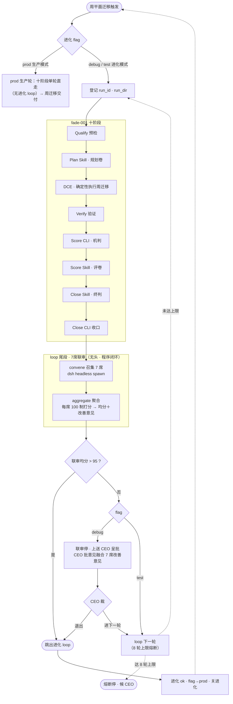
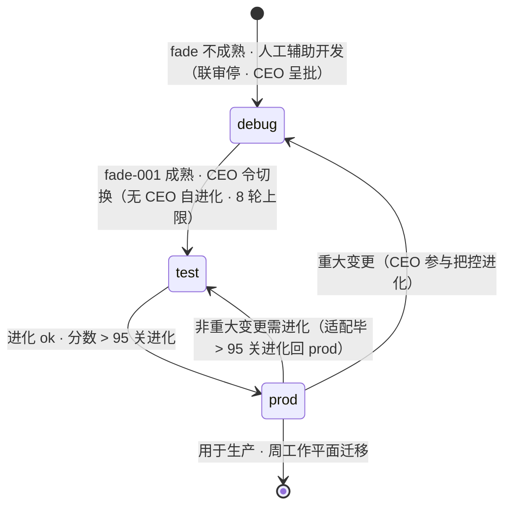

# fade-001 进化流程图（loop+fade+7席联审+flag 三态状态机）

- sourceOfTruth: 本卷（BOD 集散绘图·CEO 定谳机制可视化）
- syncMode: write-time
- lastSyncedAt: 卷面时戳锚=git commit 时戳（零手打·D-47 正形）
- 令源: CEO 口谕 2026-11-18（分数结构两裁 14:55→notice-180 / 无头勘检 13:59→notice-181 / 概念勘正 14:21→notice-182 / flag 三态定谳 14:36→notice-183）+绘图令 14:42:16+0800
- 伴随件: `fade001-loop-flag-evolution-flowchart.html`（浏览器直开图纸版·双主题）

## 图一 · 进化 loop 主流程（debug / test / prod 三路）



## 图二 · flag 生命周期（切换权 = CEO 令）



## 参数卡

| 面 | 定谳 |
|---|---|
| 卷面分数 | 100 制＝客观题 65＋主观题 35（比例不合理 COS 代裁改定呈报） |
| 联审判据 | 7 席各 100 制打分取均分，>95 跳出 loop（边界 ≥95 COS 勘定备案） |
| 改善意见 | 双 topic 必付＋三件套（rationale/evidence_ref/check_time），缺=fail-closed；CEO 批意见融合面在 debug 态 |
| 保险丝 | test 态 8 轮上限熔断候 CEO |
| 权属 | flag 三态切换权=CEO 令（权属不变·notice-182 G4 承） |
| 现役映射 | r1 案形态（converge→候 CEO 终认→意见融合裁进/出）≈debug 态现行实例（勘定归 COS 规划卷呈报） |

## 终端 ASCII 简版

```
                        ┌─────────────────────────────────────────┐
                        │  flag 状态机（切换权 = CEO 令）          │
                        │                                         │
                        │  [debug]──成熟·CEO令──>[test]──进化ok──>[prod]
                        │     ↑                      │              │        │
                        │     └──重大变更────────────┘              │        │
                        │                非重大变更(适配毕>95)↺回prod │        │
                        └─────────────────────────────────────────┘

  周迁移触发
     │
     ├─ flag=prod ──> 十阶段单轮直走 ──> 周迁移交付（无进化 loop）
     │
     └─ flag=debug/test ──> 进化 loop 一轮：
            fade-001 十阶段
            (触发→登记→Qualify→Plan Skill→DCE→Verify→Score CLI
             →Score Skill→Close Skill→Close CLI)
                 │
                 ▼
            7席联审尾段（无头·程序闭环）
            convene(dsh headless)→每席100制打分→aggregate(均分+改善意见)
                 │
                 ▼
            均分 > 95 ? ──是──> 跳出 loop ──> flag→prod 关进化
                 │否
                 ├─ debug: 联审停→上送CEO呈批→批意见融合7席改善意见→CEO裁进/出
                 └─ test : 直进下一轮（8轮上限熔断候CEO）
                        │
                        └──> 回到下一轮 fade-001
```

—— BOD（集散绘图·锚笔在案至第 185 轮）·落卷时戳锚=commit %cI（零手打·D-47 零占位）
